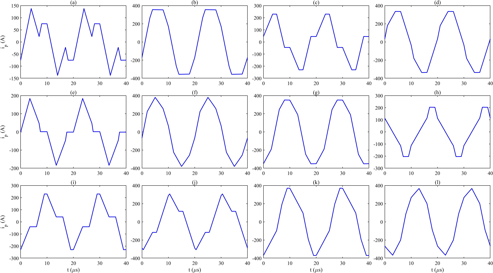

# A Unified Exact State-Space Model for the Triple-Phase-Shift Dual Active Bridge

One model for every triple-phase-shift (TPS) operating mode of the dual active bridge (DAB), for both forward (G2V) and reverse (V2G) power flow, with no per-mode equations.

Under TPS modulation, the three duty variables `D1`, `D2` and `D3` produce many different AC-link current shapes. The usual approach derives one analytical model per shape (mode). This repository instead builds a single exact discrete-time state-space model that works for any duty triplet.



*Steady-state AC-link current `i_p` over two switching periods for the 12 example duty triplets in `dab_params.m`, all computed by the same `dab_period_map` function. (a)–(f): G2V modes 1–6; (g)–(l): V2G modes 1′–6′.*

## Contributions

I have proposed an edge-sorting algorithm that generates all eight switching edges of a period from the duty triplet, wraps them modulo 2π and sorts them, so that every TPS mode, in both forward and reverse power flow, falls into the same eight-interval frame without any per-mode equations. I have exploited the half-wave symmetry of the TPS edge set: the second-half edges are the first-half edges shifted by π, so all eight edges follow from only four phase angles. I have also exploited the periodicity of the converter: by wrapping the edges over one period and imposing `x_{m+1} = x_m`, the periodic steady state is obtained directly as `x* = (I − G_p)⁻¹ H_p`, without simulating the converter until it settles.

## Method

1. **Switching edges.** For a duty triplet `D = [D1, D2, D3]`, the eight switching edges of one period are generated, wrapped modulo 2π and sorted. This turns every TPS mode into the same frame of eight sub-intervals.
2. **Switching states.** The bridge states `s1, s2 ∈ {−1, 0, +1}` are evaluated at the midpoint of each sub-interval.
3. **Interval dynamics.** On each sub-interval, the five-state model (AC-link current, input and output filter currents, input and output capacitor voltages) is linear and time-invariant: `ẋ = A_k x + f`.
4. **Exact interval map.** Each interval is solved exactly with the matrix exponential (no averaging): `x(t_{k+1}) = E_k x(t_k) + ψ_k`.
5. **Unified period map.** Cascading the eight interval maps gives one map per switching period:
   `x_{m+1} = G_p(D) x_m + H_p(D, V)`.
6. **Periodic steady state.** `x* = (I − G_p)⁻¹ H_p`, which exists when all eigenvalues of `G_p` lie inside the unit circle.
7. **Small-signal model.** Linearising about the steady state gives `δx_{m+1} = A_d δx_m + B_D δD_m`, with `A_d = G_p(D_0)` and `B_D` computed by centred finite differences.

The full derivation is in [`UnificationofDualActiveBridge.pdf`](UnificationofDualActiveBridge.pdf).

## Files

| File | Purpose |
|---|---|
| `dab_params.m` | Converter parameters and one example duty triplet per mode (6 G2V, 6 V2G) |
| `dab_period_map.m` | Edge sorting, interval matrices, exact interval maps, and the period map `G_p`, `H_p` |
| `dab_linearize.m` | Periodic steady state, `A_d`, `B_D`, and the discrete-time state-space system |
| `five_state_calculator.m` | Plots all five states over two periods at steady state |
| `fig_link_current.png` | AC-link current for the 12 example modes |
| `UnificationofDualActiveBridge.pdf` | Derivation |

## How to run

```matlab
five_state_calculator      % steady-state waveforms of the five states
L = dab_linearize([0.8 0.3 0.4], dab_params());   % small-signal model at one operating point
```

Requires MATLAB with the Control System Toolbox.

## Parameters used in the code

| Parameter | Code name | Value |
|---|---|---|
| Primary / secondary DC voltage | `V1`, `V2` | 800 V, 800 V |
| Turns ratio | `n` | 1.7 |
| Switching frequency | `fs` | 50 kHz |
| AC-link inductance / resistance | `L`, `R` | 15 µH, 25 mΩ |
| Input filter | `L1`, `R1`, `C1` | 10 µH, 100 mΩ, 30 µF |
| Output filter | `L2`, `R2`, `C2` | 10 µH, 100 mΩ, 44 µF |

## Notation and conventions

- **Names:** code `L, R, L1, R1, C1, L2, R2, C2` correspond to `L_s, R_s, L_i, R_i, C_i, L_o, R_o, C_o` in the PDF.
- **Duty convention:** edge-referenced TPS. `D1, D2 ∈ (0, 1]` are the inner shifts of the primary and secondary bridges, and `D3` is the displacement between the rising edges of the reference legs. Power direction is set by the centre shift `D3c = D3 − (D1 − D2)/2`: forward for `D3c ∈ (0, 1)`, reverse for `D3c ∈ (−1, 0)`.
- **Output sign:** `dab_linearize.m` outputs `+i_Lo`; the PDF samples `−i_Lo` as the delivered current.
- **Mode labels:** the labels in `dab_params.m` are this code's own (modes 1–6 for G2V, 1′–6′ for V2G) and do not follow a published classification.
- **Coincident edges:** when two edges coincide, the zero-length interval maps to the identity matrix, so no special handling is needed.

## Author

Amina Bashir, MSc Electrical Engineering, Politecnico di Milano
